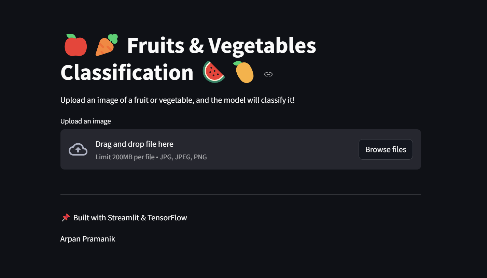

# 🍎🥕 Fruits & Vegetables Classification System



[](https://www.python.org/)
[](https://www.tensorflow.org/)
[](https://streamlit.io/)
[](LICENSE)

**Dataset:** [Fruit and Vegetable Image Recognition](https://www.kaggle.com/datasets/kritikseth/fruit-and-vegetable-image-recognition)

---

## 📌 Project Overview

This project is a **deep learning-based image classification system** designed to accurately identify various types of fruits and vegetables from uploaded images. Built using **TensorFlow/Keras** and deployed with **Streamlit**, it leverages the power of **EfficientNet**, a state-of-the-art convolutional neural network architecture, to deliver high-accuracy predictions with an intuitive web interface.

The system processes user-uploaded images, performs real-time inference, and provides detailed classification results including confidence scores and visual probability distributions. This project demonstrates practical applications of transfer learning and deep learning in computer vision for food classification tasks.

---

## ✨ Key Features

### 🎯 Core Functionality
- **Multi-Class Classification**: Identifies 36 different categories of fruits and vegetables
- **Real-Time Predictions**: Instant classification with confidence scores
- **Interactive Web Interface**: User-friendly Streamlit-based UI for seamless image uploads
- **Confidence Visualization**: Bar chart representation of prediction probabilities
- **High Accuracy**: Utilizes EfficientNet architecture for superior performance

### 🔧 Technical Highlights
- **Transfer Learning**: Pre-trained EfficientNet model fine-tuned for fruit/vegetable classification
- **Image Preprocessing**: Automated resizing and normalization pipeline
- **Model Optimization**: Trained with data augmentation for improved generalization
- **Lightweight Deployment**: Streamlit Cloud-ready application
- **Extensible Architecture**: Easy to add new categories and retrain

---

## 🏗️ Project Structure

```plaintext
fruit-veg-classification/
│
├── .github/
│   └── workflows/           # CI/CD workflows
│       └── python-app.yml
│
├── app.py                   # Main Streamlit application
├── Computer_vision.py       # Model training and evaluation script
│
├── efficient_model.h5       # Pre-trained EfficientNet model (primary)
├── cnn_model.h5            # Alternative CNN model
│
├── fruit-veg-detection.ipynb      # Initial model development notebook
├── fruit-veg-detection-2.ipynb    # Advanced model experimentation
│
├── requirements.txt         # Python dependencies
├── .gitignore              # Git ignore rules
├── LICENSE                 # MIT License
├── README.md              # Project documentation
└── image.png              # Project banner image
```

---

## 📊 Dataset Information

**Source**: [Kaggle - Fruit and Vegetable Image Recognition](https://www.kaggle.com/datasets/kritikseth/fruit-and-vegetable-image-recognition)

### Dataset Specifications
- **Total Categories**: 36 classes (fruits and vegetables)
- **Image Format**: RGB images of varying sizes
- **Data Split**: Train, validation, and test sets
- **Preprocessing**: Images resized to 224×224 pixels for model input

### Sample Categories Include:
- Fruits: Apple, Banana, Orange, Mango, Grape, Watermelon, etc.
- Vegetables: Carrot, Tomato, Potato, Cabbage, Cucumber, Broccoli, etc.

---

## 🧠 Model Architecture

### EfficientNet Backbone

The project utilizes **EfficientNet**, a family of convolutional neural networks that uniformly scale network width, depth, and resolution using a compound coefficient. This approach delivers state-of-the-art accuracy with fewer parameters.

**Architecture Highlights:**
- **Base Model**: EfficientNetB0 (pre-trained on ImageNet)
- **Transfer Learning**: Fine-tuned top layers for fruit/vegetable classification
- **Input Shape**: 224×224×3 (RGB images)
- **Output Layer**: Softmax activation with 36 classes
- **Optimization**: Adam optimizer with categorical cross-entropy loss

**Model Performance:**
- High training accuracy achieved through data augmentation
- Robust generalization on unseen test images
- Fast inference time suitable for real-time applications

---

## 🚀 Installation & Setup

### Prerequisites
- Python 3.8 or higher
- pip package manager
- Git

### Step 1: Clone the Repository

```bash
git clone https://github.com/arpanpramanik2003/fruit-veg-classification.git
cd fruit-veg-classification
```

### Step 2: Create Virtual Environment (Recommended)

```bash
# Create virtual environment
python -m venv venv

# Activate virtual environment
# On Windows:
venv\Scripts\activate
# On macOS/Linux:
source venv/bin/activate
```

### Step 3: Install Dependencies

```bash
pip install -r requirements.txt
```

**Key Dependencies:**
- TensorFlow 2.x
- Streamlit
- NumPy
- Pillow (PIL)
- Matplotlib

---

## 💻 Usage

### Running the Web Application

```bash
streamlit run app.py
```

The application will automatically open in your default web browser at `http://localhost:8501`

### Using the Application

1. **Upload Image**: Click on the file uploader to select an image of a fruit or vegetable
2. **View Prediction**: The system will display the predicted class name
3. **Confidence Score**: Check the confidence percentage for the prediction
4. **Probability Distribution**: Examine the bar chart showing probabilities for all classes

### Live Demo

Access the deployed application: [Fruit-Veg Classification App](https://fruit-veg-detection-custom-cnn-arpan.streamlit.app/)

---

## 🔬 Model Training & Customization

### Training Your Own Model

If you want to retrain the model with custom data:

1. **Prepare Dataset**: Organize images in folders by class name
2. **Run Training Script**:
   ```bash
   python Computer_vision.py
   ```
3. **Explore Notebooks**: Use the Jupyter notebooks for experimentation:
   - `fruit-veg-detection.ipynb` - Initial model development
   - `fruit-veg-detection-2.ipynb` - Advanced experiments

### Customization Options

- **Add New Categories**: Expand the dataset with additional fruit/vegetable classes
- **Model Architecture**: Experiment with different EfficientNet variants (B1, B2, etc.)
- **Hyperparameter Tuning**: Adjust learning rate, batch size, and epochs
- **Data Augmentation**: Implement custom augmentation strategies

---

## 📷 Model Inference Pipeline

1. **Image Upload**: User uploads image through Streamlit interface
2. **Preprocessing**: 
   - Convert image to RGB format
   - Resize to 224×224 pixels
   - Normalize pixel values
3. **Model Prediction**: Feed preprocessed image to EfficientNet model
4. **Post-processing**: 
   - Extract class probabilities
   - Identify top prediction
   - Calculate confidence score
5. **Visualization**: Display results with bar chart

---

## 📊 Results & Performance

### Model Metrics
- **Architecture**: EfficientNetB0
- **Input Resolution**: 224×224 pixels
- **Training Strategy**: Transfer learning with fine-tuning
- **Performance**: High accuracy on test dataset

### Sample Predictions
The model successfully identifies various fruits and vegetables with high confidence, handling variations in:
- Lighting conditions
- Image angles and perspectives
- Background complexity
- Fruit/vegetable ripeness stages

---

## 🤝 Contributing

Contributions are welcome! Here's how you can help:

1. **Fork the Repository**
2. **Create Feature Branch**: `git checkout -b feature/YourFeature`
3. **Commit Changes**: `git commit -m 'Add YourFeature'`
4. **Push to Branch**: `git push origin feature/YourFeature`
5. **Open Pull Request**

### Contribution Ideas
- Add support for new fruit/vegetable categories
- Improve model accuracy with advanced architectures
- Enhance UI/UX of the web application
- Implement batch prediction functionality
- Add multi-language support
- Create mobile application version

---

## 🗺️ Roadmap

### Current Version (v1.0)
- ✅ EfficientNet-based classification
- ✅ Streamlit web interface
- ✅ 36 fruit/vegetable categories
- ✅ Confidence score visualization

### Planned Features (v2.0)
- 🔄 Enhanced model with Vision Transformers
- 🔄 Real-time webcam classification
- 🔄 Nutritional information display
- 🔄 Multi-image batch processing
- 🔄 Mobile app development (React Native/Flutter)
- 🔄 API endpoint for integration
- 🔄 Docker containerization
- 🔄 Cloud deployment optimization

### Future Enhancements (v3.0)
- 📅 Object detection for multiple items
- 📅 Freshness/quality assessment
- 📅 Calorie estimation
- 📅 Recipe recommendations
- 📅 Multi-language support
- 📅 Voice-activated interface

---

## 🛠️ Troubleshooting

### Common Issues

**Issue**: Model file not found
- **Solution**: Ensure `efficient_model.h5` is in the project root directory

**Issue**: TensorFlow installation errors
- **Solution**: Install TensorFlow 2.x compatible with your Python version

**Issue**: Image upload fails
- **Solution**: Verify image format (JPG, PNG supported)

**Issue**: Streamlit app won't start
- **Solution**: Check if port 8501 is available or specify different port

---

## 🙏 Acknowledgements

- **Dataset**: Thanks to [Kritik Seth](https://www.kaggle.com/kritikseth) for the Fruit and Vegetable Image Recognition dataset on Kaggle
- **EfficientNet**: Implementation based on Google's EfficientNet paper
- **Streamlit**: For providing an excellent framework for rapid ML app development
- **TensorFlow/Keras**: For comprehensive deep learning tools
- **Open Source Community**: For continuous inspiration and support

---

## 📜 License

This project is licensed under the **MIT License** - see the [LICENSE](LICENSE) file for details.

```
MIT License

Copyright (c) 2024 Arpan Pramanik

Permission is hereby granted, free of charge, to any person obtaining a copy
of this software and associated documentation files (the "Software"), to deal
in the Software without restriction, including without limitation the rights
to use, copy, modify, merge, publish, distribute, sublicense, and/or sell
copies of the Software, and to permit persons to whom the Software is
furnished to do so, subject to the following conditions:

The above copyright notice and this permission notice shall be included in all
copies or substantial portions of the Software.
```

---

## 📧 Contact

**Developer**: Arpan Pramanik  
**Role**: AI/ML Enthusiast 🚀  
**GitHub**: [@arpanpramanik2003](https://github.com/arpanpramanik2003)  

For questions, suggestions, or collaboration opportunities, feel free to reach out!

---

## ⭐ Support

If you find this project helpful, please consider:
- ⭐ Starring the repository
- 🍴 Forking for your own experiments
- 📢 Sharing with others
- 🐛 Reporting issues
- 💡 Suggesting improvements

---

<div align="center">

**Made with ❤️ by Arpan Pramanik**

**Powered by TensorFlow • Streamlit • EfficientNet**

</div>
